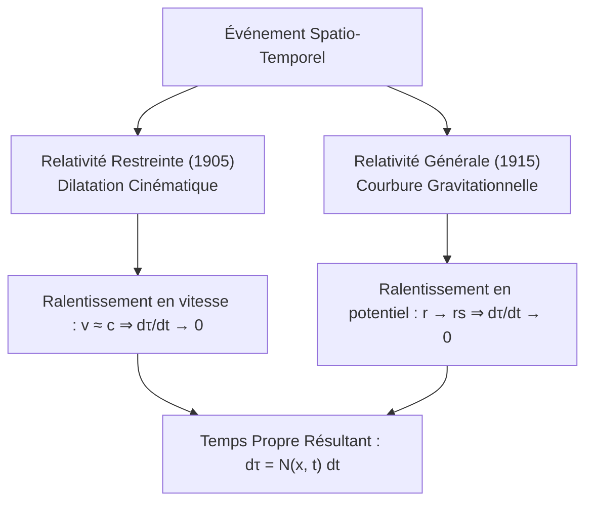
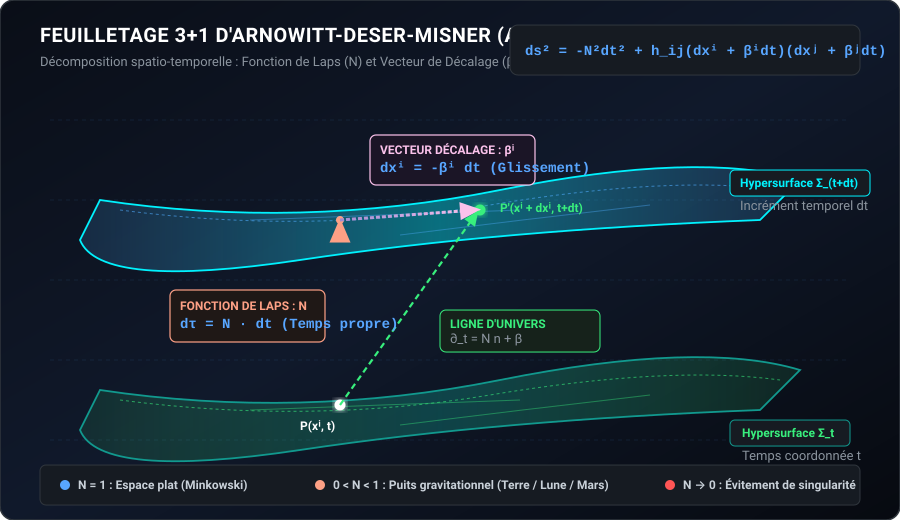
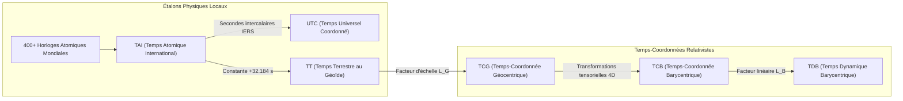
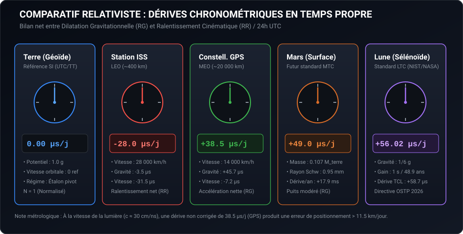

# Chronométrie Relativiste, Formalisme ADM et Standardisation Temporelle Cislunaire : De la Fonction de Laps au Temps Lunaire Coordonné (LTC)

> **Document d'étude de synthèse (*Review Article*)**  
> **Auteur :** Jules Reymond  
> **Date de publication :** 13 octobre 2026  
> **Licence :** Creative Commons Attribution - Pas d'Utilisation Commerciale - Pas de Modification 4.0 International (CC BY-NC-ND 4.0)  
> **Identifiant de métadonnées :** [CITATION.cff](file:///e:/Reste/PROJET_PERSO/Laps/CITATION.cff)  

---

> [!WARNING]
> **Avertissement éditorial et critique épistémologique**  
> La soumission d'une recherche théorique à une revue scientifique à comité de lecture (*peer-review*) requiert une rigueur métrologique absolue :
> 1. Le terme « laps » ne doit pas être introduit comme une unité arbitraire nouvelle, mais s'inscrit rigoureusement dans la **fonction de laps** adimensionnelle ($N$ ou $\alpha$) codifiée dans la décomposition hamiltonienne 3+1 d'Arnowitt-Deser-Misner (ADM, 1962), ainsi que dans les facteurs d'échelle gravitationnels ($L_G$, $L_B$) standardisés par l'Union Astronomique Internationale (UAI) et le Bureau International des Poids et Mesures (BIPM).
> 2. L'équation de flux temporel $\partial_t \Phi = -\frac{4\pi G}{c^4 r} T^t_r$ est restreinte à une symétrie sphérique statique sous coordonnées adaptées et ne constitue pas une loi universelle remplaçant les équations d'Einstein complètes.
> 3. En cosmologie standard (métrique FLRW), le temps cosmique pose conventionnellement $N = 1$ ; l'approche de la singularité initiale ne correspond pas à une divergence $\Phi \to +\infty$.

---

## Résumé

Cet article de synthèse examine le cadre théorique et métrologique régissant les variations locales de l'écoulement du temps propre en relativité restreinte et générale. À travers la décomposition hamiltonienne 3+1 d'Arnowitt-Deser-Misner (ADM), la fonction de laps ($N$) est analysée comme l'opérateur géométrique reliant le temps propre ($\tau$) au temps-coordonnée ($t$). L'étude expose la transposition empirique de ce formalisme au sein des échelles de temps atomiques terrestres (TAI, UTC, TT, TCG, TCB) et des infrastructures orbitales (GPS, ISS). Enfin, elle évalue les paramètres physiques, les architectures de positionnement, navigation et synchronisation (PNT), ainsi que les cadres normatifs internationaux (résolutions de l'UAI et directives de l'OSTP) entourant l'implémentation du Temps Lunaire Coordonné (LTC) et son extension future au système martien.

---

## 1. Introduction et Fondements Relativistes

La physique moderne substitue au temps absolu newtonien une variété spatio-temporelle quadridimensionnelle pseudo-riemannienne dynamique dont la métrique dépend de la distribution locale d'énergie-impulsion et de l'état cinématique de l'observateur. La divergence du temps propre entre deux référentiels distincts résulte de la superposition de deux mécanismes physiques :

1. **La dilatation temporelle cinématique (Relativité Restreinte, 1905) :**  
   Tout observateur animé d'une vitesse relative $v$ par rapport à un référentiel inertiel subit un ralentissement de son horloge propre :
   $$\frac{d\tau}{dt} = \sqrt{1 - \frac{v^2}{c^2}} = \frac{1}{\gamma}$$
   À la limite asymptotique $v \to c$, l'intervalle de temps propre s'annule ($d\tau \to 0$).

2. **La dilatation gravitationnelle (Relativité Générale, 1915) :**  
   La présence d'un champ gravitationnel courbe la géométrie de l'espace-temps et ralentit l'écoulement du temps propre à proportion de la profondeur du puits gravitationnel. Dans le cas d'une métrique statique à symétrie sphérique (Schwarzschild) :
   $$\frac{d\tau}{dt} = \sqrt{1 - \frac{2GM}{r c^2}} = \sqrt{1 - \frac{r_s}{r}}$$

> [!NOTE]
> Ce différentiel chronométrique est strictement géométrique. Il demeure entièrement indépendant de l'agitation thermique locale : amener un système au zéro absolu ($0\text{ K}$) suspend la thermodynamique moléculaire mais n'altère en rien la vitesse de défilement de sa ligne d'univers métrique. L'approche conceptuelle du « projet Laps » formalise ce coefficient d'écoulement sous la forme d'un opérateur scalaire strictement positif, tendant vers zéro aux limites extrêmes.

---

## 2. Formalisme Mathématique : Décomposition ADM et Fonction de Laps

L'analyse de l'évolution temporelle d'un système gravitationnel dynamique et l'intégration numérique des équations d'Einstein sur supercalculateurs imposent une scission de la variété quadridimensionnelle en tranches spatiales successives via le formalisme **ADM (Arnowitt, Deser, Misner, 1962)**.

### 2.1. Feuilletage Spatio-Temporel et Métrique 3+1

Le formalisme ADM partitionne l'espace-temps en une famille continue d'hypersurfaces tridimensionnelles spatiales $\Sigma_t$ paramétrées par une coordonnée temporelle globale $t$. L'intervalle invariant $ds^2$ prend la forme standard 3+1 :

$$ds^2 = -N^2 dt^2 + h_{ij} \left( dx^i + \beta^i dt \right) \left( dx^j + \beta^j dt \right)$$

Les grandeurs géométriques fondamentales sont :
* $h_{ij}$ (ou $\gamma_{ij}$) : Tenseur métrique induit sur l'hypersurface 3D, définissant les distances spatiales intrinsèques.
* $\beta^i$ (ou $N^i$) : Vecteur de décalage (*shift vector*), mesurant le glissement tangentiel des coordonnées spatiales d'une tranche à la suivante (indispensable pour décrire l'effet Lense-Thirring et l'entraînement des référentiels autour des corps en rotation rapide).
* $N$ (ou $\alpha$) : **Fonction de laps (*lapse function*)**, opérateur scalaire déterminant l'écartement géodésique normal entre deux tranches successives.

### 2.2. Équation Différentielle du Temps Propre et Liberté de Jauge

Pour un observateur immobile par rapport aux coordonnées spatiales de l'hypersurface avec un vecteur de décalage nul ($\beta^i = 0$), la relation différentielle fondamentale s'écrit :

$$d\tau = N \, dt$$

La valeur locale de la fonction de laps $N$ caractérise directement le potentiel métrique :

| Valeur de $N$ | Régime Physique | Interprétation Chronométrique |
| :--- | :--- | :--- |
| **$N = 1$** | Espace asymptotiquement plat (Minkowski) | Le temps propre coïncide avec le temps-coordonnée ($d\tau = dt$) |
| **$0 < N < 1$** | Puits gravitationnel fini (Terre, Lune, Mars, étoiles) | Ralentissement gravitationnel du temps propre |
| **$N \to 0$** | Horizon des événements (Schwarzschild / Kerr) | Gel asymptotique de l'écoulement temporel vu par l'observateur lointain |

> [!TIP]
> **Évitement de Singularité en Relativité Numérique :**  
> Lors de la fusion de trous noirs ou d'étoiles à neutrons, choisir une jauge constante $N = 1$ provoquerait l'effondrement du calcul informatique en un temps fini. Les physiciens programment des conditions de jauge dynamiques (telles que le *1+log slicing* ou le découpage à courbure moyenne maximale) où $N \to 0$ au voisinage immédiat de la zone d'effondrement, ce qui « gèle » localement l'avancement temporel numérique et permet à la simulation de se poursuivre indéfiniment à l'extérieur.

### 2.3. Contraintes Hamiltoniennes et Formulation Logarithmique

Dans le lagrangien d'Einstein-Hilbert, $N$ et $\beta^i$ n'ont pas de dérivée temporelle dynamique : ils jouent le rôle de multiplicateurs de Lagrange.
* La variation de l'action par rapport à $N$ impose la **contrainte hamiltonienne** : $\mathcal{H} = 0$.
* La variation par rapport à $\beta^i$ produit la **contrainte de moment / impulsion** : $\mathcal{M}_i = 0$.

Sous une reformulation exponentielle où la fonction de laps s'écrit $N = e^\Phi$ avec un potentiel temporel $\Phi$, la dérivée temporelle sous hypothèse de symétrie sphérique statique s'exprime selon le tenseur énergie-impulsion radial $T^t_r$ :

$$\partial_t \Phi = -\frac{4\pi G}{c^4 r} T^t_r$$

Un flux massique entrant ($T^t_r < 0$) creuse le puits gravitationnel et fait chuter la fonction de laps, tandis qu'un flux nul ($T^t_r = 0$) assure la stationnarité du champ conformément au théorème de Birkhoff.

---

## 3. Métrologie Spatiale et Échelles de Temps Relativistes

La mise en application concrète du formalisme relativiste est administrée mondialement par le BIPM, l'IERS, l'UAI et les laboratoires nationaux de métrologie.

### 3.1. Redéfinition Quantique de la Seconde SI

Historiquement indexée sur la rotation terrestre ($1/86\,400$ du jour solaire moyen), la seconde a dû être déconnectée de la mécanique céleste en raison du ralentissement séculaire des marées lunaires (~1,4 ms/siècle). Après l'intermède du Temps des Éphémérides (ET, 1956), la 13e Conférence Générale des Poids et Mesures (CGPM) de 1967 a fixé l'étalon universel :

$$\text{1 seconde SI} = 9\,192\,631\,770 \text{ oscillations de la transition hyperfine du Césium 133}$$

### 3.2. Taxonomie et Hiérarchie des Échelles de Temps

La dérive séculaire entre le Temps-Coordonnée Géocentrique ($TCG$) et le Temps Terrestre ($TT$) à la surface du géoïde est rigoureusement régie par la constante gravitationnelle $L_G$ :

$$TCG - TT = \frac{L_G}{1 - L_G} \times (JD_{TT} - 2443144.5003725) \times 86400 \text{ s}$$

avec la constante normalisée UAI :
$$L_G = 6{,}969290134 \times 10^{-10}$$

De même, l'échelle interplanétaire $TCB$ est connectée à l'échelle dynamique $TDB$ par le facteur :
$$L_B = 1{,}550519768 \times 10^{-8}$$

---

## 4. Vérifications Empiriques et Standardisation Cislunaire

### 4.1. Dynamique en Orbite Terrestre : GPS et ISS

* **Système GPS (MEO, altitude $\approx 20\,200\text{ km}$, vitesse $\approx 14\,000\text{ km/h}$) :**  
  À cette altitude, le potentiel gravitationnel est diminué : l'effet de relativité générale accélère les oscillateurs de $+45{,}7\,\mu\text{s/jour}$. En contrepartie, la vitesse orbitale induit un ralentissement de relativité restreinte de $-7{,}2\,\mu\text{s/jour}$.  
  $$\Delta t_{\text{net}} = +45{,}7 - 7{,}2 = +38{,}5\,\mu\text{s/jour}$$
  Sans correction relativiste matérielle (abaissement d'usine de la fréquence de base de $10{,}23\text{ MHz}$ à $10{,}22999999543\text{ MHz}$) et logicielle, les signaux accumuleraient une erreur métrique sur le positionnement au sol de :
  $$\Delta x = c \times \Delta t \approx (3 \times 10^8\text{ m/s}) \times (38{,}5 \times 10^{-6}\text{ s}) \approx 11{,}55\text{ km/jour}$$

* **Station Spatiale Internationale (LEO, altitude $\approx 400\text{ km}$, vitesse $\approx 28\,000\text{ km/h}$) :**  
  En orbite basse, la vitesse cinématique prend le dessus sur la faible réduction du potentiel gravitationnel : les horloges de bord accusent un retard net de $-25$ à $-30\,\mu\text{s/jour}$. Sur une mission de 6 mois, les astronautes reviennent sur Terre plus jeunes d'environ $5\text{ ms}$.

### 4.2. Le Temps Lunaire Coordonné (LTC)

La gravité à la surface sélène n'étant que d'environ $1/6\,g_{\text{Terre}}$, une horloge atomique posée sur le sélénoïde tourne plus vite qu'au géoïde terrestre. Les calculs publiés en 2024 dans *The Astronomical Journal* par l'équipe du NIST établissent une accélération moyenne de :

$$\Delta \tau_{\text{Lune}} = +56{,}02\,\mu\text{s/jour}$$

Soit un décalage net cumulé de **1 seconde tous les 48,9 ans**.

> [!IMPORTANT]
> **Directives et Résolutions 2024 :**
> * **Mémorandum OSTP (Maison Blanche, 2 avril 2024) :** Mandat officiel donné à la NASA pour déployer le **Temps Lunaire Coordonné (LTC)** d'ici le 31 décembre 2026.
> * **Distinction métrologique fondamentale :** L'écart entre $+56{,}02\,\mu\text{s/jour}$ (sélénoïde vs géoïde) et $+58{,}7\,\mu\text{s/jour}$ provient de la définition des référentiels : $+58{,}7\,\mu\text{s/jour}$ représente la dérive théorique centre-à-centre idéale entre le Temps-Coordonnée Lunaire ($TCL$) et le Temps-Coordonnée Géocentrique ($TCG$), sans soustraction des potentiels de surface.
> * **UAI (Assemblée Générale du Cap, août 2024) :** Adoption conjointe de la **Résolution II** (cadre de référence LCRS et temps $TCL$) et de la **Résolution III** (norme internationale LTC sous supervision du BIPM).

---

## 5. Synthèse Métrologique et Extension Martienne (MTC)

Le tableau ci-dessous récapitule les paramètres physiques et métrologiques across le système solaire interne :

| Environnement d'Exploitation | Paramètres Physiques | Mécanisme Dominant | Dérive Nette / 24h UTC | Dérive Annuelle Cumulée |
| :--- | :--- | :--- | :--- | :--- |
| **Terre (Géoïde)** | $1{,}0\,g$, $v_{\text{rot}} \le 465\text{ m/s}$ | Étalon International | $0{,}00\,\mu\text{s}$ (Référence) | $0{,}00\text{ ms}$ |
| **ISS (LEO, $400\text{ km}$)** | $v \approx 7{,}66\text{ km/s}$ | Cinématique (RR) | **$-28{,}0\,\mu\text{s}$** | $-10{,}2\text{ ms}$ |
| **GPS (MEO, $20\,200\text{ km}$)** | $v \approx 3{,}87\text{ km/s}$, $r = 26\,600\text{ km}$ | Gravitation (RG) | **$+38{,}5\,\mu\text{s}$** | $+14{,}05\text{ ms}$ |
| **Mars (Surface - Jezero)** | $M = 0{,}107\,M_\oplus$, $r_s = 0{,}952\text{ mm}$ | Gravitation (RG) | **$+49{,}0\,\mu\text{s}$** | $+17{,}88\text{ ms}$ |
| **Lune (Sélénoïde)** | $g \approx 0{,}166\,g_\oplus$, orbite elliptique | Gravitation (RG) | **$+56{,}02\,\mu\text{s}$** | $+20{,}45\text{ ms}$ |

Pour une mission martienne de 687 jours terrestres (une année martienne), l'avance cumulée atteint $+33{,}7\text{ ms}$. Le futur **Temps Martien Coordonné (MTC)** nécessitera un réseau de répéteurs orbitaux et d'horloges optiques ultra-stables affichant une déviation d'Allan $\sigma_{\text{Allan}} \le 10^{-15}$ sur 24 heures et un protocole de recalibration bidirectionnel continu.

---

## Simulateur Interactif Associé

Le projet intègre un tableau de bord de simulation en temps réel exécutable dans tout navigateur web :  
👉 **[Ouvrir le simulateur interactif (visualizer.html)](file:///e:/Reste/PROJET_PERSO/Laps/visualizer.html)**

---

## Références Bibliographiques et Textes Normatifs

1. **Arnowitt, R., Deser, S., & Misner, C. W. (1962).** *The Dynamics of General Relativity.* In L. Witten (Ed.), Gravitation: An Introduction to Current Research (pp. 227–265). John Wiley & Sons.
2. **Bureau International des Poids et Mesures (BIPM).** *Comptes Rendus de la 13e Conférence Générale des Poids et Mesures (1967/68).* Définition atomique de la seconde.
3. **Union Astronomique Internationale (UAI).** *Résolutions II et III adoptées lors de la 32e Assemblée Générale (Le Cap, 2024).* Établissement du LCRS, du TCL et du Temps Lunaire Coordonné (LTC).
4. **Executive Office of the President of the United States (OSTP).** *Policy on Celestial Time Standardization in Support of the National Cislunar Science and Technology Strategy.* Washington, D.C., 2 avril 2024.
5. **Ashby, N., & Patla, B. R. (2024).** *Relativistic Time Transfer and Clock Synchronization in the Cislunar Domain.* The Astronomical Journal, NIST Special Publication.
