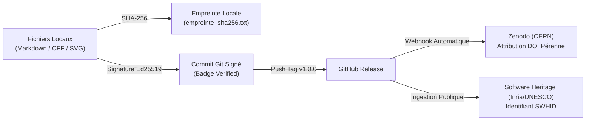

# Projet Laps : Chronométrie Relativiste & Standardisation Spatiale

[](https://creativecommons.org/licenses/by-nc-nd/4.0/)
[](https://doi.org/10.5281/zenodo.23352108)
[](#traçabilité-cryptographique-et-intégrité-légale)
[](https://archive.softwareheritage.org/browse/origin/?origin_url=https://github.com/je-tu-il/Laps)

> **Étude de synthèse sur le formalisme 3+1 d'Arnowitt-Deser-Misner (ADM), la fonction de laps ($N$), et les architectures de synchronisation spatiale (Temps Lunaire Coordonné - LTC & Temps Martien Coordonné - MTC).**

---

## 📑 Sommaire

1. [Vue d'Ensemble & Cadre Théorique](#vue-densemble--cadre-théorique)
2. [Schémas Animés & Géométrie Relativiste](#schémas-animés--géométrie-relativiste)
3. [Synthèse des Dérives Chronométriques](#synthèse-des-dérives-chronométriques)
4. [Simulateur Interactif en Temps Réel](#simulateur-interactif-en-temps-réel)
5. [Structure du Répertoire](#structure-du-répertoire)
6. [Traçabilité Cryptographique et Intégrité Légale](#traçabilité-cryptographique-et-intégrité-légale)
7. [Citation et Métadonnées](#citation-et-métadonnées)

---

## Vue d'Ensemble & Cadre Théorique

Le **Projet Laps** formalise le différentiel métrique régissant la vitesse d'écoulement du temps propre ($\tau$) par rapport au temps-coordonnée ($t$).

En relativité générale, la décomposition hamiltonienne 3+1 d'Arnowitt-Deser-Misner (ADM) segmente la variété spatio-temporelle en hypersurfaces spatiales $\Sigma_t$. La relation fondamentale d'écoulement s'écrit :

$$d\tau = N \cdot dt$$

où **$N$ est la fonction de laps (*lapse function*)**. 

* **$N = 1$ :** Espace asymptotiquement plat (Minkowski, absence de gravité).
* **$0 < N < 1$ :** Puits gravitationnel (Terre, Lune, Mars, environnement stellaire).
* **$N \to 0$ :** Horizon des événements d'un trou noir (gel asymptotique de l'écoulement temporel).

Consulter le document d'étude complet :  
👉 **[Laps_Etude.md](Laps_Etude.md)** (Formulations complètes, contraintes hamiltoniennes, résolutions UAI et directives OSTP 2026).

---

## Schémas Animés & Géométrie Relativiste

### 1. Feuilletage Spatio-Temporel ADM (3+1)
Décomposition de l'intervalle invariant $ds^2 = -N^2 dt^2 + h_{ij}(dx^i + \beta^i dt)(dx^j + \beta^j dt)$ :


### 2. Comparatif des Horloges Propres
Superposition du ralentissement cinématique (Relativité Restreinte) et de l'accélération gravitationnelle (Relativité Générale) :


---

## Synthèse des Dérives Chronométriques

Les valeurs métrologiques de référence validées par le BIPM, l'IERS et le NIST :

| Environnement | Altitude / Régime | Mécanisme Dominant | Dérive Nette / 24h UTC | Erreur de Position non corrigée |
| :--- | :--- | :--- | :--- | :--- |
| **Terre (Géoïde)** | $0\text{ m}$ (Niveau moyen des mers) | Étalon Pivot SI | **$0{,}00\,\mu\text{s/j}$** | $0\text{ m}$ (Base de référence) |
| **Station ISS** | LEO (~$400\text{ km}$, $28\,000\text{ km/h}$) | Cinématique dominant (RR) | **$-28{,}0\,\mu\text{s/j}$** | ~$8{,}4\text{ km/jour}$ |
| **Constellation GPS** | MEO (~$20\,200\text{ km}$, $14\,000\text{ km/h}$) | Gravitationnel dominant (RG) | **$+38{,}5\,\mu\text{s/j}$** | > $11{,}5\text{ km/jour}$ |
| **Mars (Surface)** | Puits modéré ($r_s = 0{,}952\text{ mm}$) | Gravitationnel (RG) | **$+49{,}0\,\mu\text{s/j}$** | ~$14{,}7\text{ km/jour}$ |
| **Lune (Sélénoïde)** | $1/6\,g_{\text{Terre}}$, orbite elliptique | Gravitationnel dominant (RG) | **$+56{,}02\,\mu\text{s/j}$** | ~$16{,}8\text{ km/jour}$ |

> [!NOTE]
> La dérive de **$+56{,}02\,\mu\text{s/jour}$** (sélénoïde/géoïde) équivaut à un gain de **1 seconde tous les 48,9 ans**. La valeur de $+58{,}7\,\mu\text{s/jour}$ mentionnée dans le mémorandum de l'OSTP (Maison Blanche, avril 2024) correspond à la dérive séculaire théorique centre-à-centre idéale ($TCL - TCG$).

---

## Simulateur Interactif en Temps Réel

Le dépôt intègre une application web de simulation autonome :
* **Horloges atomiques synchronisées en direct** avec simulation de dérive à vitesse réelle ou accélérée ($1\times$, $1\text{h/s}$, $1\text{j/s}$).
* **Canvas interactif du feuilletage ADM 3+1** et de la fonction de laps $N$.
* **Calculateur relativiste paramétrique** (Masse $M$, Rayon $r$, Vitesse $v$).

👉 **[Lancer visualizer.html](visualizer.html)** (ouvrir dans n'importe quel navigateur, 100 % autonome, sans dépendance).

---

## Structure du Répertoire

```text
Laps/
├── assets/
│   ├── animated_lapse_foliation.svg   # Schéma vectoriel animé du feuilletage 3+1 ADM
│   └── animated_clocks_drift.svg      # Schéma vectoriel animé du comparatif des dérives
├── CITATION.cff                       # Métadonnées normatives (format CFF 1.2.0)
├── LICENSE                            # Licence CC BY-NC-ND 4.0 International
├── Laps_Etude.md                      # Article de synthèse scientifique complet
├── visualizer.html                    # Simulateur interactif web (60 FPS)
├── empreinte_sha256.txt               # Empreintes cryptographiques de référence
├── Laps.txt                           # Archive brute du document source
└── README.md                          # Présentation et chaîne de traçabilité
```

---

## Traçabilité Cryptographique et Intégrité Légale

Ce projet est conçu pour fournir une **chaîne probatoire opposable** garantie par des institutions publiques internationales indépendantes :



1. **Commit & Tag Signés :** Clé SSH `ed25519` garantissant l'identité du déposant.
2. **DOI CERN (Zenodo) :** Enregistrement pérenne et immuable de l'archive ZIP horodatée au CERN.
3. **Software Heritage (Inria / UNESCO) :** Ancrage dans l'archive universelle du code source avec identifiant intrinsèque SWHID.
4. **Preuve d'Intégrité SHA-256 :** Consignée dans `empreinte_sha256.txt`.

---

## Citation et Métadonnées

Pour citer ce travail dans une publication ou un rapport technique, utilisez le fichier [CITATION.cff](CITATION.cff) ou le format BibTeX ci-dessous :

```bibtex
@article{reymond2026laps,
  author    = {Reymond, Jules},
  title     = {Le Projet Laps et la Dynamique de la Vitesse du Temps : Formalisme Relativiste, Chronométrie Spatiale et Standardisation Cislunaire},
  year      = {2026},
  month     = {10},
  version   = {1.0.0},
  doi       = {10.5281/zenodo.23352108},
  url       = {https://doi.org/10.5281/zenodo.23352108},
  note      = {Archivé sous licence CC BY-NC-ND 4.0}
}
```

---

*Licence Creative Commons Attribution - Pas d’Utilisation Commerciale - Pas de Modification 4.0 International (CC BY-NC-ND 4.0).*
